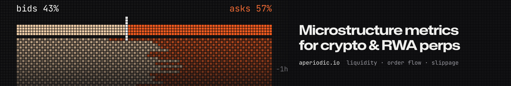
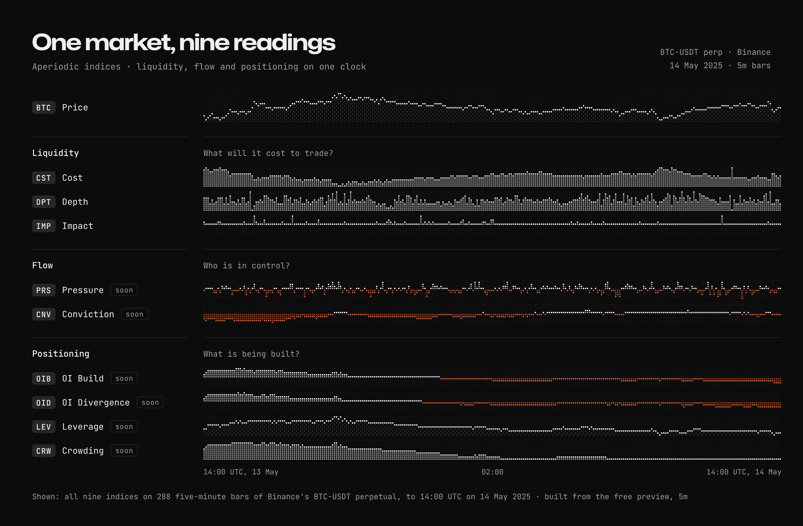

<a href="https://aperiodic.io"></a>

# Aperiodic

**Liquidity, order flow and microstructure metrics for crypto and RWA perpetuals. Point-in-time and research-ready.**

Aperiodic turns hundreds of terabytes of exchange data into point-in-time metrics: book depth and liquidity, order flow, spreads and slippage, funding, basis and open interest. Quant teams backtest and research on them directly, **100–1000x faster** than working from L2 data, without building the infrastructure.

<a href="https://aperiodic.io/free-data"></a>

[aperiodic.io](https://aperiodic.io) · [Catalog](https://aperiodic.io/catalog) · [Indices](https://aperiodic.io/indices) · [Markets](https://aperiodic.io/markets) · [API docs](https://aperiodic.io/api-docs) · [Pricing](https://aperiodic.io/pricing)

---

## Indices

<a href="https://aperiodic.io/indices">
  <picture>
    <source media="(prefers-color-scheme: dark)" srcset="assets/indices-dark.png" />
    <source media="(prefers-color-scheme: light)" srcset="assets/indices-light.png" />
    
  </picture>
</a>

Each index answers one question about a market, in one column you can read at a glance. Three families, nine indices:

| Family | Code | Index | The question | |
| --- | --- | --- | --- | --- |
| **Liquidity** · what will it cost to trade? | `CST` | Cost | What does crossing the spread cost? | [Live](https://aperiodic.io/indices/cost) |
| | `DPT` | Depth | How much can you trade at the best price? | [Live](https://aperiodic.io/indices/depth) |
| | `IMP` | Impact | How far does $1M of buying move the price? | [Live](https://aperiodic.io/indices/impact) |
| **Flow** · who is in control? | `PRS` | Pressure | Who won this bar? | Soon |
| | `CNV` | Conviction | Who has been winning, bar after bar? | Soon |
| **Positioning** · what is being built? | `OIB` | OI Build | Are positions being opened faster than usual? | Soon |
| | `OID` | OI Divergence | Are positions moving more than price explains? | Soon |
| | `LEV` | Leverage | How big are open positions next to a day of trading? | Soon |
| | `CRW` | Crowding | Are traders paying to pile in? | Soon |

The Liquidity indices are live for every contract on [aperiodic.io/indices](https://aperiodic.io/indices), 15 minutes behind. Flow and Positioning are on their way.

---

## Try it in a minute

Every dataset has a free preview slice (Binance BTC-USDT perpetual, 5m, May 2025). No account, no key.

```bash
pip install "aperiodic[polars]"
```

```python
from datetime import date
from aperiodic import get_metrics

df = get_metrics(
    metric="flow",
    exchange="binance-futures",
    symbol="perpetual-BTC-USDT:USDT",
    interval="5m",
    timestamp="exchange",
    start_date=date(2025, 5, 1),
    end_date=date(2025, 5, 31),
    preview=True,
)
```

Or hand it to your agent. The MCP server works on the preview without a key, and signs you in with OAuth for the rest:

```bash
claude mcp add --transport http aperiodic https://aperiodic.io/mcp
```

It also works from claude.ai, Claude Desktop, ChatGPT and Cursor. Prefer the terminal? The [CLI](https://github.com/aperiodic-io/cli) pulls the same slice as Parquet.

---

## What's in it

**220 metrics in 19 datasets**, from 1 minute to 1 day (15 and 30 seconds on Institutional).

| | Datasets |
| --- | --- |
| **Trades** | Flow (taker buy vs sell by trade size, with a toxicity score) · Impact (Kyle's λ, Amihud) · Slippage · Trade size · Run structure · Up/down ticks · Range · Returns and volatility |
| **Order book** | L1 price · L1 liquidity (spread, depth) · L1 imbalance · L2 liquidity and L2 imbalance at 5, 10, 20 and 25 levels |
| **Derivatives** | Funding · Basis · Open interest · Derivative price (mark, index, last) |
| **Market data** | Candlesticks · VWAP / TWAP |

**Coverage.** Every crypto perpetual on **Binance, OKX and Hyperliquid**, and **500+ RWA perpetuals** on stocks, ETFs, commodities and FX (including Hyperliquid HIP-3 markets), under the same API and the same [Atlas](https://github.com/aperiodic-io/atlas) symbols.

**Ways in.** Parquet over REST · a live WebSocket stream · the [Python client](https://github.com/aperiodic-io/client) · the [CLI](https://github.com/aperiodic-io/cli) · the [MCP server](https://aperiodic.io/mcp) · S3 and in-your-cloud delivery on Institutional.

**Free, no key.** [Markets](https://aperiodic.io/markets): every Binance, OKX and Hyperliquid perp, 15 minutes behind, with spread, depth, flow, funding, basis and Kyle's λ. Plus live funding rates for [Binance](https://aperiodic.io/funding-rates/binance), [OKX](https://aperiodic.io/funding-rates/okx) and [Hyperliquid](https://aperiodic.io/funding-rates/hyperliquid).

**Pre-flight.** Test a trading agent on a recorded day of real order books before it trades real money: [aperiodic.io/preflight](https://aperiodic.io/preflight).

Self-serve plans from $199 a month. [Pricing](https://aperiodic.io/pricing) · [Talk to us](https://aperiodic.io/booking) about Institutional.

---

## Open source

| Repository | |
| --- | --- |
| [`client`](https://github.com/aperiodic-io/client) | Python SDK: sync and async, concurrent Parquet downloads, Polars and pandas DataFrames |
| [`cli`](https://github.com/aperiodic-io/cli) | Download any dataset as Parquet from the terminal; the preview needs no key |
| [`atlas`](https://github.com/aperiodic-io/atlas) | Securities master: one symbology for crypto and RWA contracts across exchanges, always up to date |
| [`tparquet`](https://github.com/aperiodic-io/tparquet) | Parquet for time series: tick files at about half their ZSTD size, lossless, and still Parquet |
| [`notebooks`](https://github.com/aperiodic-io/notebooks) | Notebooks to get started with microstructure data |
| [`crypto-data-vendors`](https://github.com/aperiodic-io/crypto-data-vendors) | 16 crypto market data vendors compared on 40 criteria, every fact sourced and dated (we're one of the columns) |

---

[aperiodic.io](https://aperiodic.io) · [info@aperiodic.io](mailto:info@aperiodic.io) · [llms.txt](https://aperiodic.io/llms.txt)
